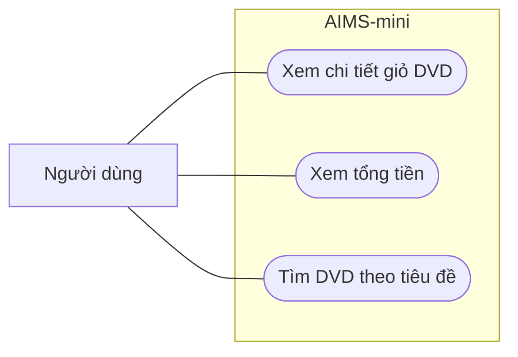

# Use case AIMS-mini - Lab 02

## Phạm vi và tác nhân

Tác nhân là người dùng xem thông tin giỏ DVD và tìm kiếm theo tiêu đề.
Ứng dụng hiện là chương trình demo dòng lệnh: `main.py` tạo dữ liệu mẫu và gọi
các thao tác; chưa có menu nhập liệu tương tác. Sơ đồ mô tả những hành vi của
mã hiện tại, không khẳng định có giao diện tương tác.



## UC01 - Xem chi tiết giỏ DVD

- **Tiền điều kiện:** đã có một đối tượng `Cart`.
- **Kích hoạt:** gọi `cart.print_cart()`; chương trình demo gọi trong `main()`.
- **Luồng chính:** duyệt DVD theo thứ tự hiện tại trong giỏ; in số thứ tự,
  tiêu đề, thể loại, giá; cuối cùng in tổng tiền.
- **Luồng thay thế:** giỏ trống thì in `The cart is empty`.
- **Hậu điều kiện:** nội dung giỏ không đổi; phương thức trả về chuỗi đã in.
- **Đối chiếu mã:** `aims/cart.py`, phương thức `Cart.print_cart()`.

## UC02 - Xem tổng tiền

- **Tiền điều kiện:** đã có một đối tượng `Cart`.
- **Luồng chính:** cộng giá của các DVD bằng `Cart.total_cost()`; phần in giỏ
  định dạng kết quả với hai chữ số thập phân.
- **Luồng thay thế:** tổng tiền của giỏ trống là 0.
- **Hậu điều kiện:** không thay đổi các DVD trong giỏ.
- **Dữ liệu demo:** 19.95 + 24.95 + 18.99 = **63.89 $**.

## UC03 - Tìm DVD theo tiêu đề

- **Đầu vào:** danh sách DVD và từ khóa kiểu chuỗi.
- **Luồng chính:** bỏ khoảng trắng ở hai đầu từ khóa; chuẩn hóa chữ hoa/thường
  bằng `casefold()`; lấy các DVD có tiêu đề chứa từ khóa đã chuẩn hóa.
- **Ví dụ:** `"  LION  "` tìm được `The Lion King`.
- **Luồng thay thế:** từ khóa rỗng, chỉ có khoảng trắng, không khớp DVD nào,
  hoặc danh sách DVD rỗng đều cho kết quả `[]`.
- **Hậu điều kiện:** trả về danh sách kết quả mới, giữ thứ tự tương đối của
  các DVD; danh sách đầu vào không bị thay đổi.
- **Đối chiếu mã:** `aims/search.py`, hàm `search_by_title()`.

## Kiểm tra thủ công

Chạy tại thư mục gốc repository:

```bash
python -B main.py
python -B -c "from aims.cart import Cart; Cart().print_cart()"
python -B -c "from aims.dvd import DigitalVideoDisc as D; from aims.search import search_by_title; print([d.title for d in search_by_title([D('The Lion King')], '  LION  ')])"
```

Kỳ vọng lần lượt: giỏ mẫu có tổng **63.89 $**; thông báo giỏ trống;
danh sách `['The Lion King']`.
